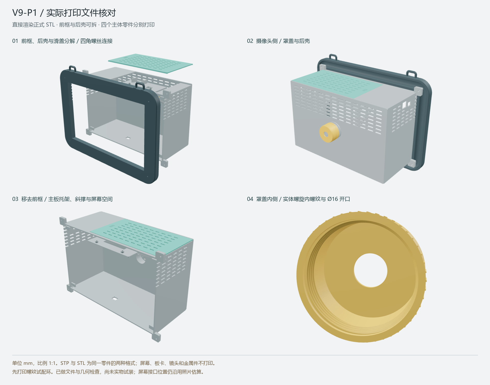

# 基于易灵思的浪漫相机

基于 Efinix Titanium Ti60F225 的五风格视频图像处理作品，包含冻结版 FPGA 网表、蓝牙控制与中文 OSD 模块，以及 V9-P1 相机外壳的打印文件和设计源文件。

本仓库用于 2026 年全国大学生嵌入式芯片与系统设计竞赛 FPGA 创新设计赛道的项目归档与团队交接，对应易灵思赛题一“AI 赋能的「实时绘画」——风格化视频渲染系统”。当前仓库为私有仓库。



*上图为正式打印网格的装配示意，屏幕和电子件不属于打印件；实物照片和演示视频尚未纳入此版本。*

## 当前版本

| 项目 | 内容 |
| --- | --- |
| FPGA 器件 | Efinix Titanium Ti60F225 |
| 代码版本 | `legacy222-ble-five-cn-20261101-ble5` |
| 顶层模块 | `ti60f225_oob_top` |
| 处理分辨率 | 1280 × 720，见原始版本说明 |
| HDMI 输出 | 1920 × 1080 @ 30 Hz，见原始版本说明 |
| AI 处理速度 | 原始说明记录约 17.1 FPS；本次归档未重新进行实板测量 |
| 风格顺序 | 漫画 → 阿凡达 → 热成像 → 像素动画 → 阴曹地府 |
| 控制 | 实体按键事件、蓝牙 UART 三类命令、中文风格名称 OSD |
| Efinity 来源版本 | 网表文件头记录 `2026.1.132` |
| 外壳 | V9-P1，2026-10-28，毫米，1:1 |

HDMI 的 30 Hz 是显示输出时序，不能等同于每秒完成 30 帧 AI 推理。五种视觉模式也不能仅凭名称认定为五套独立神经网络权重。

原始[代码说明](fpga/说明.txt)将此版本标为已实板验证的**无 RISC-V 稳定版**。此归档没有 Efinity 工程 XML、引脚/外设配置、SDC、位流或独立模型文件，因此**不能只克隆本仓库就重新生成并烧录位流**。外壳原交付说明标为首件试装阶段，尚未做实物打印装配验证。完整情况见[赛题要求对照](docs/competition-checklist.md)。

## 从哪里开始

| 需要做的事 | 文档 |
| --- | --- |
| 下载完整文件、配置已有环境 | [环境与获取方式](docs/environment.md) |
| 使用已有已烧录设备 | [使用说明](docs/usage.md) |
| 查阅 HDL 模块及接口 | [FPGA 代码说明](fpga/README.md) |
| 实现手机/串口控制 | [蓝牙命令协议](docs/ble-protocol.md) |
| 打印和装配外壳 | [V9-P1 外壳入口](mechanical/enclosure_v9/README.md) |
| 准备比赛提交、核对缺项 | [赛题对照](docs/competition-checklist.md)、[交接与提交](docs/submission.md) |
| 核验文件是否完整 | [文件完整性说明](docs/verification.md) |
| 了解代码和 IP 使用范围 | [第三方与权利说明](THIRD_PARTY_NOTICES.md) |

## 下载与校验

完整下载需要 Git 和 Git LFS。先在自己的电脑上确认已有工具可用，再执行：

```powershell
git clone https://github.com/kitty-violet/efinix-romantic-camera.git
cd efinix-romantic-camera
git lfs pull
python -B scripts/verify_repository.py
```

私有仓库需要 GitHub 账号已获访问权限；命令中的 `git` 和 `python` 应替换为本人已确认的可执行文件路径。校验脚本仅使用 Python 3.10+ 标准库，无需 PyTorch、CUDA 或训练环境。

大网表、STEP/STL/BREP 使用 Git LFS。没有拉取 LFS 时，它们可能只是几行指针文本，不能用于综合或打印。不要仅凭网页文件列表判断已下载完整文件，详见[环境说明](docs/environment.md)。

## 仓库结构

```text
.
├── fpga/
│   ├── rtl/                     冻结网表、蓝牙译码与中文 OSD
│   └── 说明.txt                 原始代码说明，原样保留
├── mechanical/enclosure_v9/
│   ├── 01_正式打印零件/         六种正式零件，STEP/STL 各一份
│   ├── 02_先打螺纹试配件/       T1/T2 试配环
│   ├── 03_三维核对/             正式件分解图、历史 V9 确认图
│   ├── 04_核对与源文件/         CAD 生成源码、参数、BREP、检查记录
│   └── 整机装配_V9_P1.stp       装配参考，不作为整体打印件
├── docs/                        环境、使用、协议、赛题及提交文档
├── manifests/source-assets.json 原始资产字节数和 SHA-256
├── scripts/verify_repository.py 文件、LFS 指针和文档链接检查
└── .github/workflows/           自动执行仓库完整性检查
```

本次只整理团队指定的当前代码与 V9 外壳，不包含历史训练实验、个人环境、账号凭据、工具安装包、厂家完整资料或其他外壳版本。正式导入资产及来源相对路径以[资产清单](manifests/source-assets.json)为准。

## 维护

先阅读[贡献与更新约定](CONTRIBUTING.md)。每次替换网表、CAD 或参数文件时，保持版本说明、校验清单和对应验证证据一致；不要将归档校验通过解释成时序收敛或实板验收通过。

版本变更记录见 [CHANGELOG](CHANGELOG.md)。本仓库未授予统一开源许可证，Efinix 原语和受保护 IP 的权利说明见 [THIRD_PARTY_NOTICES](THIRD_PARTY_NOTICES.md)。
