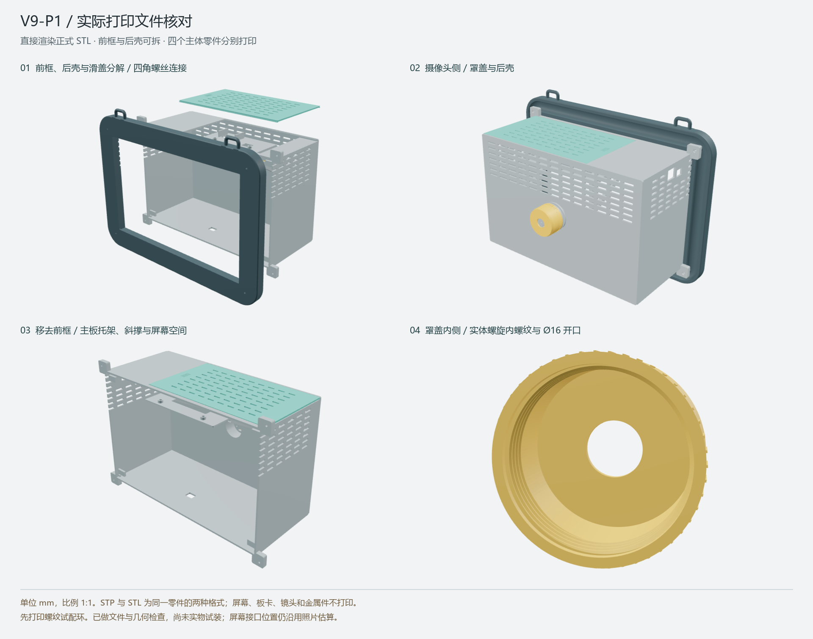

# 相机外壳 V9-P1

本目录来自团队指定的 `3D打印交付_相机外壳_V9`，版本日期 2026-10-28。正式零件、试配件、CAD 源码与关键检查记录原样保留；未混入其他外壳版本。

单位 **mm**，比例 **1:1**，切片缩放 **100%**。本版可用于报价、工艺评审和首件试装，原交付说明明确尚未做实物打印装配验证。



## 给打印商

先看本 README，再读[商家原说明](商家请先看.txt)、[装配与五金说明](装配与五金说明.md)和[零件清单](零件清单.csv)。原商家说明中提到的约 86 MiB 离线 HTML 预览未纳入仓库；装配核对使用上图和[整机 STEP](整机装配_V9_P1.stp)即可。

| 编号 | 正式件 | 每套数量 |
| --- | --- | ---: |
| 01 | 前框、实心抓边、挂绳耳 | 1 |
| 02 | 后壳、主板托架、摄像头螺纹筒 | 1 |
| 03 | 顶部散热滑盖 | 1 |
| 04 | 摄像头内螺纹罩盖 | 1 |
| 05 | 摄像头 1 mm 隔套 | 4 |
| 06 | IO 板 7.4 mm 隔套 | 2 |

从 [01_正式打印零件](01_正式打印零件/) 取件。STEP 与 STL 是同一零件的两种格式，按上表数量选一种格式，不能各打印一遍。屏幕、主板、IO 板、摄像头、线缆和金属件不是打印件。

先用正式材料和工艺打印 [T1/T2 试配环](02_先打螺纹试配件/)各一件，确认旋合后再打印大件。试配环不装入整机。螺距 2 mm，设计径向间隙 0.35 mm，需要工艺补偿时成对处理。

前框包络为 404 × 18 × 301 mm，后壳为 366 × 171 × 246 mm，以上均为 X/Y/Z 轴尺寸。商家需核对构建空间、材料收缩和去支撑方案；本包没有自动分块或预设切片方向。隔套可使用同规格金属件替代。

## 五金与装配

| 用途 | 螺丝 | 配件 |
| --- | --- | --- |
| 前后壳 | M3 × 30，4 颗 | M3 螺母 4 个 |
| 主板小孔 | M2 × 6，3 颗 | M2 螺母 3 个 |
| 主板/IO 大孔 | M3 × 16，2 颗 | M3 螺母 2 个、7.4 mm 隔套 2 个 |
| 摄像头 | M1.6 × 10，4 颗 | 螺母 4 个、外径 4.5 mm 垫片 4 个、1 mm 隔套 4 个 |

按[完整装配说明](装配与五金说明.md)操作：先试螺纹，再装摄像头与内侧螺母、排线和板卡，然后接屏幕、合前后壳，最后装滑盖和罩盖。摄像头安装需要从机身内侧操作，应在装屏幕前完成。

屏幕包络 330 × 210 × 20 mm，摄像头板 26 × 19 mm，孔距 21 × 14 mm，镜头孔直径 16 mm。摄像头排线经 14 × 3 mm 狭缝进入筒腔。实际接口位置、插头弯线、材料收缩和承载需要首件确认。

## 源文件与检查记录

- [build_print_files.py](04_核对与源文件/build_print_files.py)：CAD 实体生成与导出脚本。
- [layout_v9.json](04_核对与源文件/layout_v9.json)：尺寸和布局来源参数。
- [模型与网格检查](04_核对与源文件/模型与网格检查.json)、[交付文件最终核对](04_核对与源文件/交付文件最终核对.json)：原交付时的历史数值检查。
- [打印孔位](04_核对与源文件/打印件安装孔中心.csv)、[板卡五孔来源](04_核对与源文件/五个板卡固定孔_来源坐标.csv)、[孔位核对](04_核对与源文件/主板孔位来源核对.json)：原设计孔位依据。
- 四个主体的装配坐标 BREP 与[整机装配 STEP](整机装配_V9_P1.stp)：用于 CAD 核对；不要把整机 STEP 当成整体打印件。

历史检查记录包含八种零件的实体/网格检查。本次只对导入文件重新计算字节数和 SHA-256，没有重新执行 CAD、打印或装配测试。报告内的原路径、计时和原交付范围属于历史记录，当前仓库收录范围以[新资产清单](../../manifests/source-assets.json)为准。

[历史 V9 确认图](03_三维核对/V9确认稿_含电子件示意.png)用于查看电子件包络，其中“尚未导出”文字属于确认稿阶段；打印应以本目录 V9-P1 正式件和装配分解图为准。

## 修改 CAD

查看或打印不需要 Python。修改源码时参考[环境文档](../../docs/environment.md)中的 CadQuery 环境。

`build_print_files.py` 会读取同目录 `layout_v9.json`，将输出写入其父目录，覆盖 STEP/STL、参数副本及报告。请先把整个 `enclosure_v9` 复制到独立设计目录，在副本中修改和执行，保留本仓库的原始交付件。

```powershell
# 仅在已复制好的独立设计副本内执行，路径按本人已有环境修改。
& 'E:\your-cad-python\python.exe' -B '.\04_核对与源文件\build_print_files.py'
```

重新生成后需要更新打印说明、检查报告、零件清单及仓库资产清单，并核对实体、网格和实物试配。源码重建不保证 CAD 导出文件与原交付具有逐字节相同的校验值。
